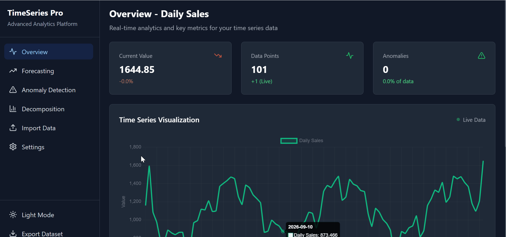

# Time Series Explorer

[](https://github.com/Tony405-spec/timeseries-explorer/actions/workflows/frontend-ci.yml)
[](https://time-series-delta.vercel.app/)

An interactive, browser-based dashboard I built as a learning project for understanding time-series concepts by implementing and visualizing them. It accepts CSV and JSON data, starts with synthetic sample datasets, and runs its analysis in the browser without a backend service.

**[Try the live demo](https://time-series-delta.vercel.app/)** · **[Read the v1.0.0 pre-release notes](https://github.com/Tony405-spec/timeseries-explorer/releases/tag/v1.0.0)**



> `assets/placehoder.gif` is also retained as a placeholder asset; the README currently displays `assets/TimeseriesDemo.gif`.

## Table of contents

- [Purpose](#purpose)
- [How to use the app](#how-to-use-the-app)
- [Features and concepts](#features-and-concepts)
- [Data formats](#data-formats)
- [Tech stack](#tech-stack)
- [Getting started](#getting-started)
- [Project structure](#project-structure)
- [Limitations](#limitations)
- [Roadmap](#roadmap)
- [Contributing](#contributing)

## Purpose

This is a learning project, not a production forecasting system. I built it to understand time-series concepts hands-on and to see how simplified methods behave on real or synthetic data.

## How to use the app

1. Start the app and choose **Overview**, **Forecasting**, **Anomaly Detection**, or **Decomposition** from the sidebar.
2. Use **Import Data** to select or drag in one CSV or JSON file. Imported data is parsed locally in the browser.
3. Use **Settings > Active Dataset** to choose which loaded series the views should analyze.
4. In **Forecasting**, select one or more methods, set the forecast horizon, and generate predictions.
5. In **Anomaly Detection**, choose Z-Score or IQR and adjust the threshold.
6. In **Decomposition**, set the seasonal period and update the component charts.
7. Use **Export Dataset** in the sidebar to download the active series as CSV. The Overview view also simulates a new point every three seconds by trimming the prior active series to its latest 100 points before appending the new point.

## Features and concepts

| Concept or feature | How it is implemented |
|---|---|
| Overview and statistics | Displays the current value, point count, anomaly count, chart, and mean, median, sample standard deviation, min, max, skewness, and excess kurtosis. See [`OverviewTab.tsx`](src/components/tabs/OverviewTab.tsx), [`StatisticsCard.tsx`](src/components/StatisticsCard.tsx), and [`statistics.ts`](src/utils/statistics.ts). |
| Trend and seasonality | The generated stock, sales, and temperature series include simple trend, periodic effects, and noise so those patterns can be explored. See [`dataGeneration.ts`](src/utils/dataGeneration.ts). |
| Forecasting | Provides linear regression, simple exponential smoothing with `alpha = 0.3`, and a seeded simplified ARIMA simulation using differencing plus fixed AR/MA coefficients (`0.5` and `0.3`). See [`ForecastingTab.tsx`](src/components/tabs/ForecastingTab.tsx) and [`statistics.ts`](src/utils/statistics.ts). |
| Anomaly detection | Offers global Z-Score detection (`abs(value - mean) / standard deviation`) and an IQR rule (`Q1 - threshold × IQR` to `Q3 + threshold × IQR`). See [`AnomalyTab.tsx`](src/components/tabs/AnomalyTab.tsx) and [`statistics.ts`](src/utils/statistics.ts). |
| Decomposition | Uses an additive-style decomposition: a moving-average trend, a seasonal component averaged by position within the period, and `residual = original - trend - seasonal`. The default period is 30, which produces a 31-point centered window away from the edges; the UI allows 7–365 days. See [`DecompositionTab.tsx`](src/components/tabs/DecompositionTab.tsx) and [`statistics.ts`](src/utils/statistics.ts). |
| Data preparation | Sorts imported CSV observations by timestamp, parses numeric values, and validates JSON observations before adding them to the dataset list. See [`DataImport.tsx`](src/components/DataImport.tsx). |
| Import and export | Accepts CSV and JSON uploads and exports the active dataset as CSV. See [`DataImport.tsx`](src/components/DataImport.tsx), [`Sidebar.tsx`](src/components/Sidebar.tsx), and [`dataExport.ts`](src/utils/dataExport.ts). |
| Themes | Includes light and dark mode toggling through a React context. See [`ThemeContext.tsx`](src/context/ThemeContext.tsx). |

The three built-in datasets are generated on startup: a synthetic stock-price-like series, daily sales with weekly and monthly effects, and temperature with annual seasonality. They are illustrative data, not real observations.

## Data formats

### CSV

The importer looks for a date column containing `date`, `time`, `timestamp`, `datetime`, or exactly `ds`, and a value column containing `value`, `price`, `amount`, `sales`, `revenue`, `y`, `close`, `open`, `high`, or `low`. It falls back to the first numeric column if no recognized value name is found. Rows with invalid dates or values are skipped, and valid rows are sorted by timestamp.

```csv
date,value
2025-01-01,100.5
2025-01-02,102.3
2025-01-03,101.8
```

### JSON

JSON must contain a non-empty `id`, `name`, and `data` array. Every observation needs a non-empty, parseable `timestamp` and a finite numeric `value`.

```json
{
  "id": "sales",
  "name": "Monthly Sales",
  "data": [
    { "timestamp": "2025-01-01", "value": 120 },
    { "timestamp": "2025-02-01", "value": 135 }
  ]
}
```

## Tech stack

| Area | Packages |
|---|---|
| Application | React 18, React DOM, TypeScript, Vite |
| Charts | Chart.js and `react-chartjs-2` |
| UI and styling | Tailwind CSS, PostCSS, Autoprefixer, `lucide-react` |
| Data handling | Papa Parse for CSV parsing |
| Testing and quality | Vitest, ESLint, TypeScript |
| Declared but not currently used by the root app | `@supabase/supabase-js`, `date-fns` |

## Getting started

The CI workflow runs on Node.js 20. Use Node.js 20 or newer locally with npm.

```bash
git clone https://github.com/Tony405-spec/timeseries-explorer.git
cd timeseries-explorer
npm ci
npm run dev
```

Open the local URL printed by Vite. The available scripts are:

| Command | Purpose |
|---|---|
| `npm run dev` | Start the Vite development server |
| `npm run build` | Create a production build |
| `npm run lint` | Run ESLint |
| `npm run test` | Run the Vitest unit tests once |
| `npm run preview` | Preview the production build locally |

The GitHub Actions workflow runs linting, tests, and a production build on pushes to `main` and on pull requests. See [`frontend-ci.yml`](.github/workflows/frontend-ci.yml).

## Project structure

```text
.
├── src/
│   ├── App.tsx                         # App shell and dataset/tab state
│   ├── components/
│   │   ├── DataImport.tsx              # CSV/JSON upload and validation
│   │   ├── Sidebar.tsx                 # Navigation, theme toggle, CSV export
│   │   ├── charts/                     # Chart.js visualizations
│   │   └── tabs/                       # Overview, forecasting, anomaly, decomposition views
│   ├── context/ThemeContext.tsx        # Light/dark theme state
│   ├── types/index.ts                  # Shared TypeScript types
│   └── utils/
│       ├── dataGeneration.ts           # Synthetic startup and live-update data
│       ├── dataExport.ts                # CSV serialization
│       └── statistics.ts                # Statistics, forecasts, anomalies, decomposition
├── assets/                             # Demo GIFs
├── .github/workflows/frontend-ci.yml   # CI checks
├── package.json                         # Root app scripts and dependencies
├── frontend/                            # Empty tracked placeholder files from an earlier layout
└── backend/                             # Empty tracked Python placeholder files; no API is wired up
```

The root `package.json` and root `src/` directory are the active application. The empty `frontend/` and `backend/` trees are not used by the current Vite app, so they may be confusing; they are left unchanged in this documentation-only PR.

## Limitations

- Sample data is synthetic and regenerated when the app starts.
- All current analysis and forecasting runs in the browser; no backend service is connected.
- The ARIMA option is explicitly a seeded simulation, not a full ARIMA implementation.
- The forecasting, anomaly detection, and decomposition methods are simplified learning implementations and are not intended for production forecasting.
- Forecast metrics are calculated from the training data (and the ARIMA simulation uses rough metrics), so they should not be treated as rigorous out-of-sample evaluation.
- There is no license file in the repository yet.

## Roadmap

- Implement a real ARIMA model.
- Decide whether to remove or build out the unused `frontend/` and `backend/` placeholders.
- Add out-of-sample forecast evaluation and broader test coverage.
- Add chart and forecast export.
- Add short explanations of each concept next to its chart.

## Contributing

For small changes, create a branch, keep the change focused, and run `npm run lint`, `npm run test`, and `npm run build` before opening a pull request. Please keep documentation aligned with the actual implementation and preserve the project's learning-focused scope.
